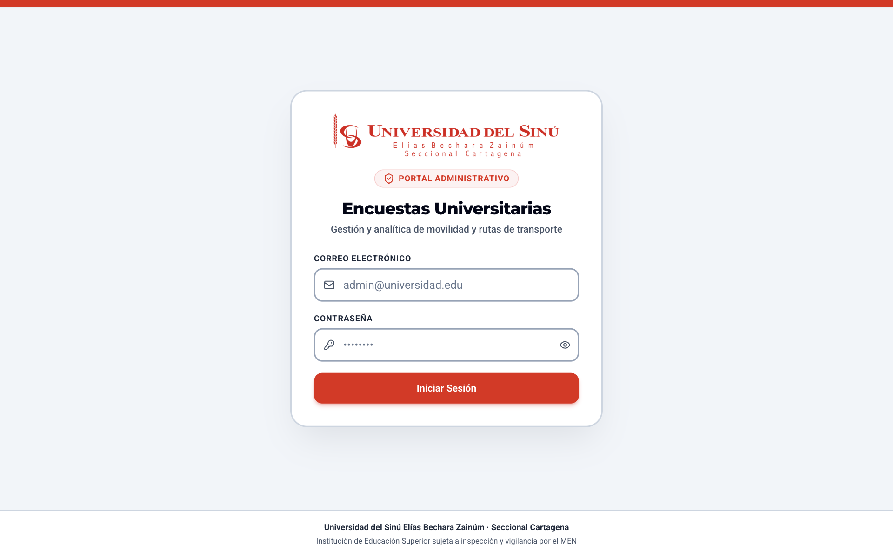
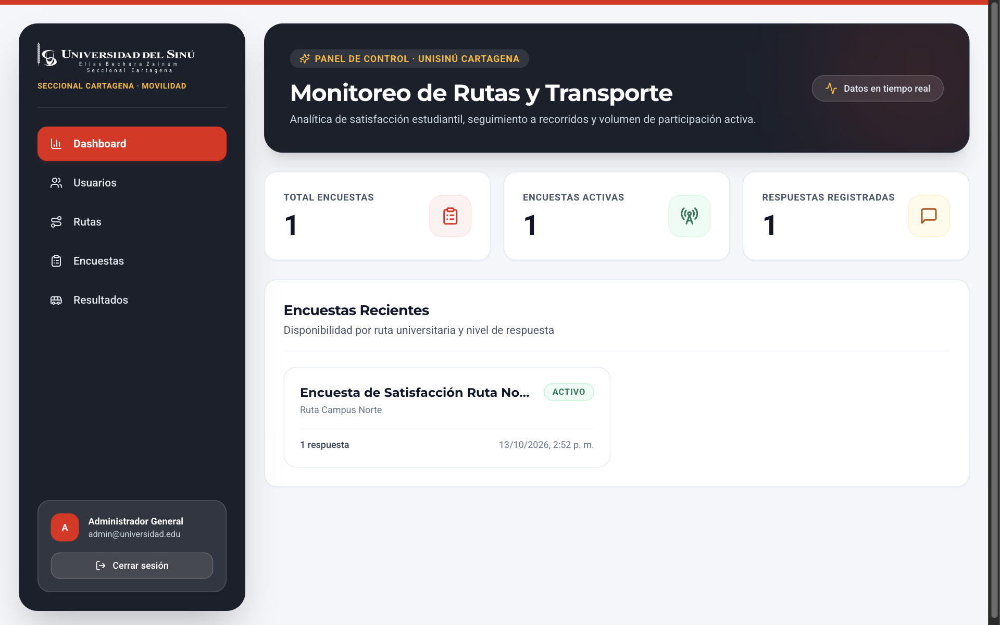
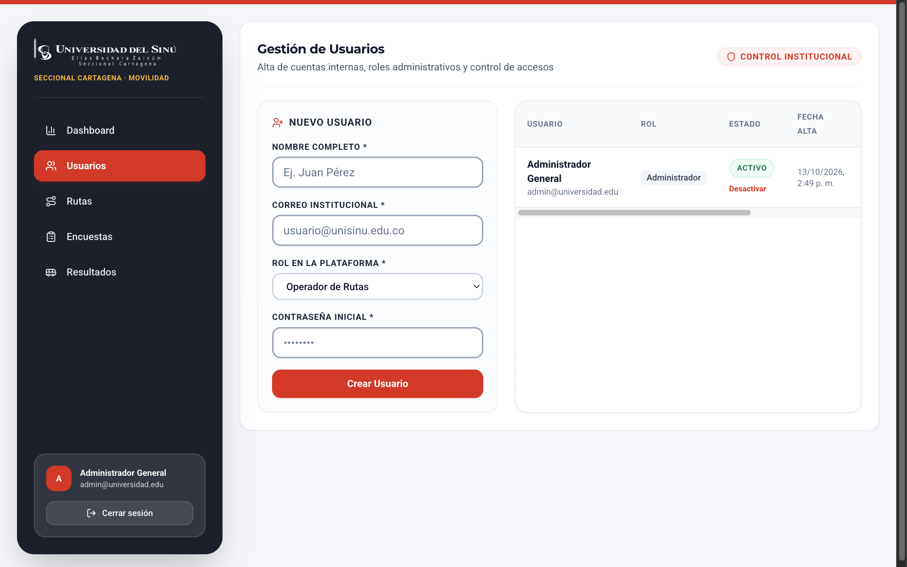
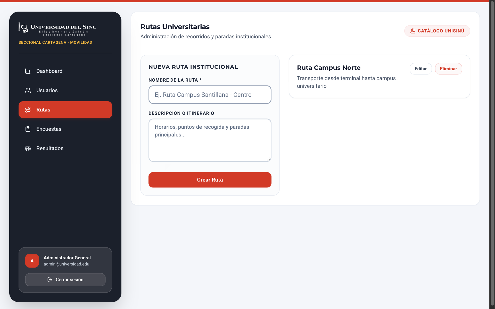
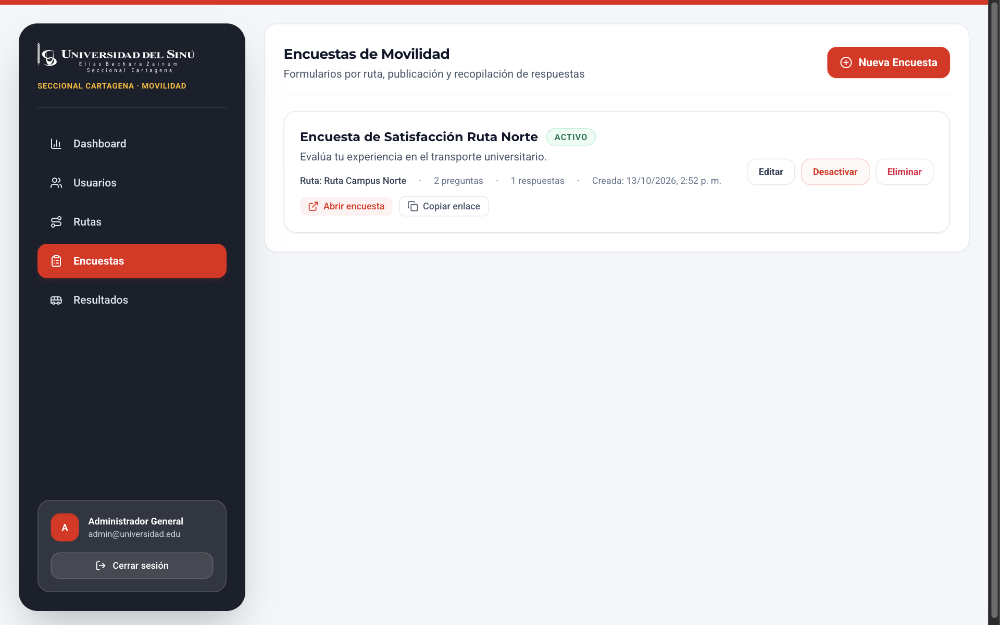
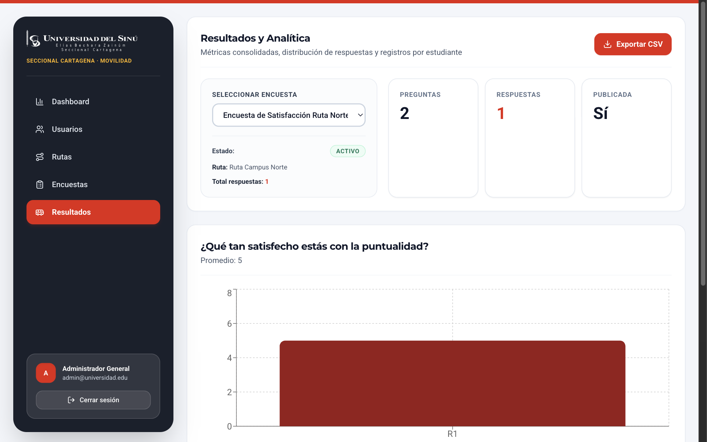

# UNIVERSIDAD DEL SINÚ SECCIONAL CARTAGENA
## ESCUELA DE INGENIERÍA DE SISTEMAS

---

# MANUAL DE USUARIO
### SISTEMA WEB DE GESTIÓN Y EVALUACIÓN DE ENCUESTAS DE RUTAS Y TRANSPORTE UNIVERSITARIO
#### (GUÍA PRÁCTICA PASO A PASO PARA ADMINISTRADORES, OPERADORES Y ESTUDIANTES)

**Institución:** Universidad del Sinú Elías Bechara Zainúm · Seccional Cartagena  
**Dependencia:** Escuela de Ingeniería de Sistemas / Dirección Administrativa de Movilidad y Bienestar  
**Ubicación y Fecha:** Cartagena de Indias, D. T. y C., Colombia – Octubre de 2026  

---

## CONTENIDO

- [I. INTRODUCCIÓN Y OBJETIVOS](#i-introducción-y-objetivos)
  - [1.1 Finalidad del Manual](#11-finalidad-del-manual)
  - [1.2 Audiencia Dirigida](#12-audiencia-dirigida)
  - [1.3 Convenciones y Simbología de la Guía](#13-convenciones-y-simbología-de-la-guía)
- [II. REQUISITOS DE ACCESO Y COMPATIBILIDAD](#ii-requisitos-de-acceso-y-compatibilidad)
  - [2.1 Navegadores Web Soportados](#21-navegadores-web-soportados)
  - [2.2 Direcciones Web de Acceso](#22-direcciones-web-de-acceso)
- [III. ROLES DE USUARIO Y PERMISOS](#iii-roles-de-usuario-y-permisos)
  - [3.1 Matriz de Roles y Funcionalidades](#31-matriz-de-roles-y-funcionalidades)
- [IV. INICIO DE SESIÓN Y GESTIÓN DE SESIÓN](#iv-inicio-de-sesión-y-gestión-de-sesión)
  - [4.1 Acceso al Sistema Administrativo](#41-acceso-al-sistema-administrativo)
  - [4.2 Mensajes de Validación y Errores Comunes](#42-mensajes-de-validación-y-errores-comunes)
  - [4.3 Cierre Seguro de Sesión](#43-cierre-seguro-de-sesión)
- [V. PANEL DE CONTROL (DASHBOARD)](#v-panel-de-control-dashboard)
  - [5.1 Barra de Navegación Lateral (Sidebar Unisinú)](#51-barra-de-navegación-lateral-sidebar-unisinu)
  - [5.2 Tarjetas de Indicadores Clave (KPIs)](#52-tarjetas-de-indicadores-clave-kpis)
  - [5.3 Listado de Encuestas Recientes](#53-listado-de-encuestas-recientes)
- [VI. GESTIÓN DE USUARIOS Y CONTROL DE ACCESO](#vi-gestión-de-usuarios-y-control-de-acceso)
  - [6.1 Registrar un Nuevo Usuario](#61-registrar-un-nuevo-usuario)
  - [6.2 Modificar Datos y Cambiar Rol](#62-modificar-datos-y-cambiar-rol)
  - [6.3 Activar o Desactivar Usuarios](#63-activar-o-desactivar-usuarios)
  - [6.4 Restablecimiento de Contraseña](#64-restablecimiento-de-contraseña)
- [VII. GESTIÓN DE RUTAS UNIVERSITARIAS](#vii-gestión-de-rutas-universitarias)
  - [7.1 Visualizar el Catálogo de Recorridos](#71-visualizar-el-catálogo-de-recorridos)
  - [7.2 Crear una Nueva Ruta](#72-crear-una-nueva-ruta)
  - [7.3 Editar o Eliminar Rutas](#73-editar-o-eliminar-rutas)
- [VIII. CONSTRUCTOR Y GESTIÓN DE ENCUESTAS](#viii-constructor-y-gestión-de-encuestas)
  - [8.1 Crear una Nueva Encuesta](#81-crear-una-nueva-encuesta)
  - [8.2 Constructor de Preguntas Dinámicas](#82-constructor-de-preguntas-dinámicas)
  - [8.3 Activación y Desactivación de Formularios](#83-activación-y-desactivación-de-formularios)
  - [8.4 Copiar y Compartir el Enlace Público](#84-copiar-y-compartir-el-enlace-público)
- [IX. DILIGENCIAMIENTO PÚBLICO (MÓDULO DEL ESTUDIANTE)](#ix-diligenciamiento-público-módulo-del-estudiante)
  - [9.1 Acceso al Formulario por Enlace Público](#91-acceso-al-formulario-por-enlace-público)
  - [9.2 Datos de Identificación del Estudiante](#92-datos-de-identificación-del-estudiante)
  - [9.3 Respuestas y Envío de la Evaluación](#93-respuestas-y-envío-de-la-evaluación)
- [X. RESULTADOS, ANALÍTICA Y EXPORTACIÓN](#x-resultados-analítica-y-exportación)
  - [10.1 Selección de Encuesta para Análisis](#101-selección-de-encuesta-para-análisis)
  - [10.2 Métricas y Gráficas de Satisfacción](#102-métricas-y-gráficas-de-satisfacción)
  - [10.3 Exportación Masiva a Archivo CSV](#103-exportación-masiva-a-archivo-csv)
- [XI. PREGUNTAS FRECUENTES (FAQ) Y SOPORTE](#xi-preguntas-frecuentes-faq-y-soporte)

---

# I. INTRODUCCIÓN Y OBJETIVOS

Bienvenido al **Manual de Usuario del Sistema de Encuestas de Rutas y Transporte Universitario** de la **Universidad del Sinú Seccional Cartagena**. 

Este sistema informático ha sido diseñado con el propósito de ofrecer a la comunidad universitaria una herramienta digital ágil, intuitiva y accesible para monitorear la puntualidad, seguridad, confort y cobertura del transporte institucional, permitiendo recopilar la opinión directa de los estudiantes en cada recorrido y generando analítica en tiempo real para la toma de decisiones por parte de la administración.

### 1.1 Finalidad del Manual
La presente guía tiene como finalidad capacitar a los usuarios finales de la plataforma en la correcta ejecución de sus actividades cotidianas. A través de instrucciones claras, directas e ilustradas con capturas reales de la interfaz, el manual orienta al usuario en cada uno de los módulos de la aplicación.

### 1.2 Audiencia Dirigida
Este documento está dirigido a tres tipos de usuarios:
1. **Superadministradores y Administradores Institucionales:** Encargados de la creación de cuentas, configuración de seguridad, altas de rutas de movilidad y supervisión general.
2. **Operadores y Coordinadores de Bienestar / Movilidad:** Responsables de crear y publicar encuestas, verificar la participación y exportar los reportes para auditoría.
3. **Estudiantes de la Universidad del Sinú:** Usuarios que utilizan el transporte universitario y diligencian las encuestas a través de dispositivos móviles o computadores.

### 1.3 Convenciones y Simbología de la Guía
Para facilitar la lectura y comprensión de los procedimientos, se utilizan los siguientes indicadores visuales:

> **[NOTA]:** Información complementaria o contextual relevante para entender el funcionamiento de un proceso.

> **[CONSEJO]:** Recomendaciones prácticas para optimizar el tiempo o mejorar la calidad de los datos registrados.

> **[IMPORTANTE]:** Instrucciones obligatorias o requerimientos previos indispensables antes de continuar.

> **[PRECAUCIÓN]:** Acciones sensibles que pueden alterar estados del sistema (por ejemplo, desactivar una encuesta activa o cerrar accesos de usuarios).

---

# II. REQUISITOS DE ACCESO Y COMPATIBILIDAD

Para utilizar la aplicación de forma óptima, no se requiere la instalación de software especializado en el equipo del usuario; únicamente se necesita un navegador web moderno y conexión a Internet.

### 2.1 Navegadores Web Soportados
La plataforma es compatible con los siguientes navegadores (versiones para escritorio y dispositivos móviles Android / iOS):
- **Google Chrome:** Versión 100 o superior (Recomendado).
- **Mozilla Firefox:** Versión 100 o superior.
- **Microsoft Edge:** Versión 100 o superior.
- **Apple Safari:** Versión 15 o superior.

### 2.2 Direcciones Web de Acceso
El sistema cuenta con dos puntos de entrada principales:
- **Panel Administrativo (Gestión y Analítica):**  
  `http://localhost:5173/iniciar-sesion` *(en producción: https://encuestas.unisinucartagena.edu.co/iniciar-sesion)*
- **Portal Público de Encuestas Estudiantiles:**  
  `http://localhost:5173/encuesta/<slug-de-la-encuesta>` *(en producción: https://encuestas.unisinucartagena.edu.co/encuesta/<slug-de-la-encuesta>)*

---

# III. ROLES DE USUARIO Y PERMISOS

El sistema implementa un esquema de **Control de Acceso Basado en Roles (RBAC)**, garantizando que cada usuario acceda exclusivamente a las funciones correspondientes a su perfil institucional.

### 3.1 Matriz de Roles y Funcionalidades

| Funcionalidad / Módulo | Super Administrador (`SUPERADMIN`) | Administrador (`ADMIN`) | Operador (`OPERATOR`) | Estudiante (Público) |
| :--- | :---: | :---: | :---: | :---: |
| **Iniciar Sesión en el Panel** | Sí | Sí | Sí | No requiere |
| **Gestión de Cuentas de Usuario** | Total | Solo lectura | Denegado | Denegado |
| **Restablecer Contraseñas** | Sí | Denegado | Denegado | Denegado |
| **Crear y Editar Rutas** | Sí | Sí | Solo lectura | Denegado |
| **Diseñar y Publicar Encuestas** | Sí | Sí | Sí | Denegado |
| **Activar / Desactivar Encuesta** | Sí | Sí | Sí | Denegado |
| **Diligenciar Encuesta Pública** | No aplica | No aplica | No aplica | **Sí (Libre)** |
| **Ver Métricas y Gráficas** | Sí | Sí | Sí | Denegado |
| **Exportar Resultados a CSV** | Sí | Sí | Sí | Denegado |

---

# IV. INICIO DE SESIÓN Y GESTIÓN DE SESIÓN

### 4.1 Acceso al Sistema Administrativo

Para ingresar al panel de control institucional, siga los pasos descritos a continuación:

1. Abra su navegador web e ingrese a la dirección: `http://localhost:5173/iniciar-sesion`.
2. Se presentará en pantalla el formulario oficial de inicio de sesión con la identidad institucional de la **Universidad del Sinú Seccional Cartagena**.
3. En el campo **Correo Electrónico Institucional**, ingrese su dirección registrada (ejemplo: `admin@universidad.edu`).
4. En el campo **Contraseña**, escriba su clave de acceso confidencial.
5. Haga clic en el botón rojo **Iniciar Sesión**.

*(Imagen Ilustrativa: Pantalla de Login de la Universidad del Sinú)*  

### 4.2 Mensajes de Validación y Errores Comunes
- **"Credenciales inválidas":** Ocurre si el correo electrónico o la contraseña ingresada no coinciden con los registros del sistema. Verifique que no tenga activada la tecla Bloq Mayús y que no haya espacios en blanco adicionales.
- **"Usuario inactivo":** Si su cuenta ha sido deshabilitada temporalmente por la administración, el sistema rechazará la solicitud. Contacte al Superadministrador para restablecer el estado.
- **Campos obligatorios:** Si intenta enviar el formulario sin completar el correo o la contraseña, el sistema resaltará el campo en rojo indicando la obligatoriedad.

### 4.3 Cierre Seguro de Sesión
Para resguardar la confidencialidad de la información cuando termine de trabajar:
1. Diríjase a la parte inferior de la barra de navegación lateral izquierda.
2. Ubique la tarjeta que muestra su nombre y correo de sesión.
3. Haga clic sobre el botón **Cerrar sesión** con el icono de salida.
4. El sistema eliminará inmediatamente el token seguro de su navegador y lo redireccionará a la pantalla de bienvenida.

---

# V. PANEL DE CONTROL (DASHBOARD)

Al ingresar exitosamente al sistema, será recibido por el **Panel de Monitoreo de Rutas y Transporte**, el cual ofrece una visión ejecutiva del estado de las encuestas y la participación estudiantil.

*(Imagen Ilustrativa: Tablero Principal del Dashboard)*  

### 5.1 Barra de Navegación Lateral (Sidebar Unisinú)
El menú lateral oscuro (`bg-[#1a202c]`) permite acceder a todas las secciones del sistema:
- **Dashboard:** Retorna a la pantalla principal de métricas y resumen.
- **Usuarios:** Gestión de cuentas administrativas y roles de acceso.
- **Rutas:** Catálogo de recorridos y transporte institucional.
- **Encuestas:** Creación, edición, activación y enlace de cuestionarios.
- **Resultados:** Análisis gráfico por pregunta y exportación masiva a CSV.

> **En dispositivos móviles:** El menú lateral se oculta automáticamente. Para desplegarlo, presione el botón de menú hamburguesa (☰) ubicado en la esquina superior derecha del encabezado móvil.

### 5.2 Tarjetas de Indicadores Clave (KPIs)
En la parte superior se destacan tres métricas consolidadas en tiempo real:
1. **Total Encuestas:** Muestra la cantidad acumulada de encuestas registradas en el sistema.
2. **Encuestas Activas:** Indica cuántas encuestas se encuentran habilitadas en este momento para recibir respuestas de los estudiantes.
3. **Respuestas Registradas:** Refleja el total de envíos completados por los estudiantes en todas las encuestas.

### 5.3 Listado de Encuestas Recientes
La sección inferior agrupa las encuestas creadas recientemente, mostrando:
- Título de la encuesta.
- Ruta de transporte vinculada (ej. *Ruta Campus Norte*).
- Distintivo de estado: Verde (**ACTIVO**) o Gris (**INACTIVO**).
- Contador de respuestas recibidas hasta el momento.

---

# VI. GESTIÓN DE USUARIOS Y CONTROL DE ACCESO

Este módulo permite a los administradores registrar, actualizar y mantener al día las cuentas de los funcionarios que operan el sistema.

*(Imagen Ilustrativa: Módulo de Gestión de Usuarios)*  

### 6.1 Registrar un Nuevo Usuario
1. En el menú lateral, seleccione la opción **Usuarios**.
2. En el panel superior derecho, ubique el formulario **Crear Nuevo Usuario**.
3. Complete los campos obligatorios:
   - **Nombre Completo:** Ingrese nombres y apellidos (ej. *Carlos Montalvo*).
   - **Correo Electrónico:** Dirección institucional (ej. *coordinador.movilidad@unisinu.edu.co*).
   - **Contraseña Inicial:** Clave temporal de acceso (mínimo 6 caracteres).
   - **Rol de Usuario:** Seleccione en el menú desplegable entre `ADMIN` (Administrador) u `OPERATOR` (Operador).
4. Haga clic en el botón rojo **Crear Usuario**.
5. El nuevo usuario aparecerá inmediatamente en la tabla inferior y podrá autenticarse.

### 6.2 Modificar Datos y Cambiar Rol
1. En la tabla de usuarios registrados, ubique la fila correspondiente al funcionario.
2. Presione el botón **Editar**.
3. Podrá actualizar el nombre, corregir la dirección de correo o ascender/descender el rol del usuario.
4. Presione **Guardar Cambios** para confirmar la modificación.

### 6.3 Activar o Desactivar Usuarios
Para suspender temporalmente el acceso de un usuario sin eliminar su historial:
1. Ubique al usuario en la tabla.
2. Haga clic en el botón de estado o en el interruptor de activación.
3. Si el usuario pasa a estado inactivo (badge gris), cualquier sesión activa que mantenga será rechazada automáticamente por el sistema de seguridad JWT.

### 6.4 Restablecimiento de Contraseña
1. Presione el botón **Cambiar Contraseña** en la fila del usuario seleccionado.
2. En la ventana modal emergente, ingrese la nueva contraseña deseada.
3. Haga clic en **Actualizar Contraseña**. El hash criptográfico se regenerará de manera segura en la base de datos.

---

# VII. GESTIÓN DE RUTAS UNIVERSITARIAS

El módulo de **Rutas** permite catalogar los diferentes recorridos de transporte operados o contratados por la Universidad del Sinú para el traslado de los estudiantes.

*(Imagen Ilustrativa: Catálogo de Rutas Institucionales)*  

### 7.1 Visualizar el Catálogo de Recorridos
Al ingresar a la sección **Rutas**, el sistema presenta la lista de recorridos configurados con su nombre oficial, descripción de paraderos u horarios, y el número de encuestas asociadas a cada recorrido.

### 7.2 Crear una Nueva Ruta
1. En la barra superior de acciones, haga clic en el botón **Nueva Ruta**.
2. Complete la información requerida en el formulario:
   - **Nombre de la Ruta:** Ingrese un nombre descriptivo y claro (ej. *Ruta Campus Norte - Terminal de Transportes*).
   - **Descripción del Recorrido:** Detalle las estaciones principales, puntos de parada, horarios pico o información relevante de la prestación del servicio.
3. Presione el botón **Guardar Ruta**.
4. La ruta quedará disponible de inmediato para asociarle encuestas de evaluación.

### 7.3 Editar o Eliminar Rutas
- **Editar:** Permite actualizar el nombre o ajustar la descripción de las paradas.
- **Eliminar:** Si una ruta fue creada por error y **no cuenta con encuestas vinculadas**, podrá ser eliminada. Si ya posee encuestas o respuestas históricas asociadas, el sistema protegerá la integridad de los datos impidiendo el borrado accidental (`RESTRICT`).

---

# VIII. CONSTRUCTOR Y GESTIÓN DE ENCUESTAS

El módulo de **Encuestas** es el núcleo de la plataforma, permitiendo diseñar instrumentos de evaluación flexibles con diversos tipos de preguntas y compartirlos fácilmente con los estudiantes.

*(Imagen Ilustrativa: Listado de Encuestas de Movilidad)*  

### 8.1 Crear una Nueva Encuesta
1. Ingrese a la opción **Encuestas** del menú lateral.
2. Haga clic en el botón rojo **Nueva Encuesta**.
3. Complete los datos generales del formulario:
   - **Título de la Encuesta:** Nombre de la evaluación (ej. *Encuesta de Satisfacción Ruta Norte - II Semestre*).
   - **Descripción:** Texto explicativo dirigido a los estudiantes indicando el propósito de la encuesta.
   - **Ruta Universitaria:** Seleccione en el menú desplegable la ruta sobre la cual se medirá el servicio.
   - **Slug Público:** El sistema genera automáticamente un identificador amigable para la URL (ej. `satisfaccion-ruta-norte-2026`). Puede personalizarlo si lo desea, garantizando que sea único.
   - **Fechas de Vigencia (Opcional):** Puede definir una fecha y hora de inicio y de cierre automático.

### 8.2 Constructor de Preguntas Dinámicas
En la sección del constructor, presione **Agregar Pregunta** para diseñar el cuestionario. El sistema soporta seis (6) tipos de preguntas:

1. **Texto Corto (`SHORT_TEXT`):** Para respuestas breves en una sola línea (ej. *¿En cuál paradero abordas habitualmente?*).
2. **Texto Largo (`LONG_TEXT`):** Para comentarios, sugerencias o quejas detalladas en un área de texto amplia.
3. **Selección Única (`SINGLE_CHOICE`):** El estudiante solo puede marcar una opción de una lista (ej. *¿Con qué frecuencia usas la ruta?: Todos los días / Ocasionalmente / Rara vez*).
4. **Selección Múltiple (`MULTIPLE_CHOICE`):** Permite al estudiante seleccionar una o varias opciones mediante casillas de verificación (ej. *¿Qué aspectos destacarías?: Puntualidad, Limpieza, Seguridad*).
5. **Calificación por Estrellas (`RATING`):** Escala intuitiva del 1 al 5 con estrellas interactivas (1 = Muy bajo, 5 = Excelente), ideal para calificar el trato del conductor o la comodidad del vehículo.
6. **Valor Numérico (`NUMBER`):** Para recolectar cifras exactas (ej. *¿Cuántos minutos esperas en promedio la ruta?*).

> **Configuraciones adicionales por pregunta:**
> - Marque la casilla **Obligatoria** si la pregunta debe ser respondida obligatoriamente para poder enviar el formulario.
> - Utilice las flechas de orden para reorganizar la secuencia de las preguntas en el cuestionario.

### 8.3 Activación y Desactivación de Formularios
Una vez finalizado el diseño:
- Si el interruptor de estado se encuentra en **Activo** (verde), el formulario estará visible públicamente y aceptará respuestas.
- Si cambia el estado a **Inactivo** (gris), cualquier estudiante que intente ingresar al enlace recibirá un mensaje informando que la encuesta no se encuentra disponible temporalmente.

### 8.4 Copiar y Compartir el Enlace Público
1. En el listado general de encuestas, ubique la encuesta activa deseada.
2. Haga clic en el botón con el icono de enlace **Copiar Enlace**.
3. El sistema copiará la URL directa al portapapeles y mostrará la confirmación en verde: **¡Copiado!**.
4. Comparta este enlace por correo institucional, código QR en los vehículos o portales de la Universidad del Sinú.

---

# IX. DILIGENCIAMIENTO PÚBLICO (MÓDULO DEL ESTUDIANTE)

La vista pública de la encuesta ha sido diseñada específicamente para ofrecer una experiencia limpia, rápida y de alto contraste en teléfonos inteligentes y computadores de los estudiantes.

*(Imagen Ilustrativa: Formulario Público de Diligenciamiento para Estudiantes)*  

### 9.1 Acceso al Formulario por Enlace Público
El estudiante no necesita iniciar sesión ni tener credenciales administrativas; solo debe abrir el enlace proporcionado:  
`http://localhost:5173/encuesta/<slug>`

Al cargar la página, se muestra el logotipo oficial de la Universidad del Sinú, la franja roja institucional, el título de la encuesta y la ruta correspondiente.

### 9.2 Datos de Identificación del Estudiante
Antes de responder las preguntas, la primera tarjeta solicita los datos académicos obligatorios para garantizar la veracidad de la muestra:
- **Código Estudiantil (\*):** Ejemplo: `202410123`.
- **Nombre Completo (\*):** Nombres y apellidos del estudiante.
- **Correo Institucional (\*):** Debe ser una dirección de correo válida (ej. `estudiante@unisinu.edu.co`).

### 9.3 Respuestas y Envío de la Evaluación
1. El estudiante recorre las preguntas ordenadas secuencialmente.
2. Cada tipo de pregunta responde visualmente a la interacción:
   - Los campos de texto tienen bordes definidos y texto oscuro legible.
   - Las preguntas de calificación muestran botones del 1 al 5 que se iluminan en rojo Unisinú al seleccionarse.
   - Las opciones de selección única y múltiple cuentan con casillas amplias de fácil toque en pantallas móviles.
3. Al finalizar, el estudiante presiona el botón rojo inferior **Enviar Respuestas**.
4. El sistema valida que todas las preguntas requeridas hayan sido contestadas. Si falta alguna, el navegador le indicará cuál campo requiere atención.
5. Al completarse exitosamente, se presenta un mensaje de confirmación y agradecimiento, garantizando que los datos han sido archivados en la base de datos institucional.

---

# X. RESULTADOS, ANALÍTICA Y EXPORTACIÓN

El módulo de **Resultados** consolida la información recopilada para su evaluación cuantitativa y cualitativa.

*(Imagen Ilustrativa: Tablero Analítico y Resultados por Encuesta)*  

### 10.1 Selección de Encuesta para Análisis
1. Ingrese a la opción **Resultados** del menú lateral.
2. En el panel izquierdo, utilice el menú desplegable **Seleccionar Encuesta** para escoger el instrumento que desea analizar.
3. Se mostrará el resumen inmediato: Estado (Activo/Inactivo), Ruta vinculada y Total de respuestas acumuladas.

### 10.2 Métricas y Gráficas de Satisfacción
El área principal presenta gráficos dinámicos generados automáticamente según el tipo de pregunta:
- **Gráficos de Barras y Sectores:** Para preguntas de selección única o múltiple, ilustrando el porcentaje y número exacto de estudiantes que eligieron cada opción.
- **Promedios de Calificación:** En preguntas de tipo escala o rating, muestra el promedio ponderado sobre 5.0, permitiendo evaluar la satisfacción de la ruta de un vistazo.

### 10.3 Exportación Masiva a Archivo CSV
Para auditorías de calidad o análisis estadístico avanzado en Excel, SPSS o Power BI:
1. En la esquina superior derecha del panel de resultados, haga clic en el botón rojo **Exportar CSV**.
2. El sistema compilará de forma instantánea todos los envíos registrados para esa encuesta.
3. El archivo generado incluirá:
   - Cabeceras dinámicas: Código, Nombre, Correo del estudiante, Fecha y hora exacta de envío, y una columna por cada pregunta de la encuesta.
   - Filas completas con las respuestas exactas de cada estudiante.
4. El archivo se descargará automáticamente en su equipo con el nombre:  
   `<slug-de-la-encuesta>-resultados.csv`.

---

# XI. PREGUNTAS FRECUENTES (FAQ) Y SOPORTE

### 1. ¿Qué debo hacer si olvidé mi contraseña de administrador?
Comuníquese con el Superadministrador de la Escuela de Ingeniería de Sistemas o el Administrador General del sistema. Desde el módulo **Usuarios**, el administrador puede generar una nueva contraseña para su cuenta en cuestión de segundos.

### 2. ¿Los estudiantes necesitan descargar alguna aplicación para responder las encuestas?
No. La plataforma está desarrollada como una aplicación web responsiva (PWA/SPA). Funciona directamente desde cualquier navegador web de smartphone (Chrome, Safari, Edge, etc.) sin necesidad de descargas en las tiendas de aplicaciones.

### 3. ¿Puedo modificar las preguntas de una encuesta que ya está activa y recibiendo respuestas?
Sí, puede editar el enunciado o agregar nuevas preguntas. Sin embargo, se recomienda **no eliminar opciones de respuesta existentes** si ya hay estudiantes que las han seleccionado, para evitar discrepancias en los porcentajes históricos de la analítica.

### 4. ¿Por qué una encuesta no carga cuando un estudiante abre el enlace?
Verifique en el módulo de **Encuestas** que el interruptor de estado se encuentre en **Activo**. Si la encuesta está marcada como inactiva o ya superó su fecha límite de cierre, el formulario no admitirá nuevas participaciones.

### 5. ¿Cómo contacto al soporte técnico de la plataforma?
Para reportar incidentes técnicos, solicitudes de nuevas funciones o mantenimiento correctivo:
- **Dependencia:** Escuela de Ingeniería de Sistemas – Universidad del Sinú Seccional Cartagena.
- **Ubicación:** Campus Universitario Santillana / Plaza Colón, Cartagena de Indias, Colombia.
- **Correo de Soporte:** `soporte.sistemas@unisinucartagena.edu.co`.

---

**Aprobado por:** Dirección Administrativa de Movilidad y Escuela de Ingeniería de Sistemas  
**Universidad del Sinú Elías Bechara Zainúm – Seccional Cartagena**  
*Documento Oficial de Operación – Registro de Usuario Versión 1.0.*
