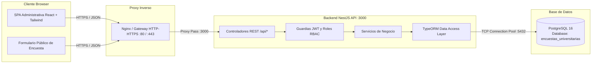
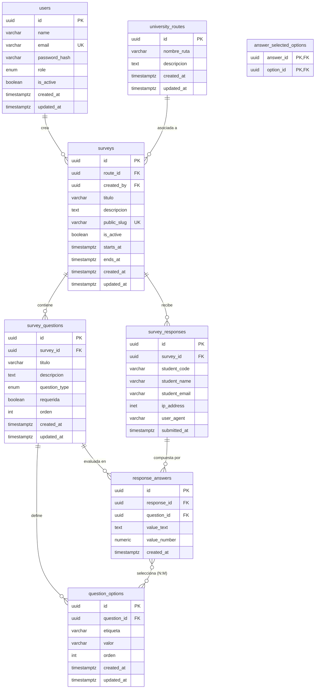

# UNIVERSIDAD DEL SINÚ SECCIONAL CARTAGENA
## ESCUELA DE INGENIERÍA DE SISTEMAS

---

# MANUAL TÉCNICO
### SISTEMA WEB DE GESTIÓN Y EVALUACIÓN DE ENCUESTAS DE RUTAS Y TRANSPORTE UNIVERSITARIO
#### (MONITOREO DE SATISFACCIÓN Y MOVILIDAD ESTUDIANTIL)

**Institución:** Universidad del Sinú Elías Bechara Zainúm · Seccional Cartagena  
**Dependencia:** Escuela de Ingeniería de Sistemas / Dirección Administrativa de Movilidad y Bienestar  
**Ubicación y Fecha:** Cartagena de Indias, D. T. y C., Colombia – Octubre de 2026  

---

## CONTENIDO

- [I. INTRODUCCIÓN](#i-introducción)
  - [1.1 Propósito del Manual](#11-propósito-del-manual)
  - [1.2 Alcance del Sistema](#12-alcance-del-sistema)
  - [1.3 Objetivos Técnicos](#13-objetivos-técnicos)
  - [1.4 Audiencia Dirigida](#14-audiencia-dirigida)
- [II. REQUISITOS DEL SISTEMA](#ii-requisitos-del-sistema)
  - [2.1 Requisitos de Hardware](#21-requisitos-de-hardware)
  - [2.2 Requisitos de Software](#22-requisitos-de-software)
- [III. REQUERIMIENTOS DEL SISTEMA](#iii-requerimientos-del-sistema)
  - [3.1 Requerimientos Funcionales (Épicas e Historias de Usuario)](#31-requerimientos-funcionales)
  - [3.2 Requerimientos No Funcionales](#32-requerimientos-no-funcionales)
- [IV. DISEÑO DEL SISTEMA](#iv-diseño-del-sistema)
  - [4.1 Diagrama Funcional y Casos de Uso](#41-diagrama-funcional-y-casos-de-uso)
  - [4.2 Diseño de la Arquitectura del Sistema](#42-diseño-de-la-arquitectura-del-sistema)
  - [4.3 Diseño de la Base de Datos (Modelo Relacional)](#43-diseño-de-la-base-de-datos)
  - [4.4 Diccionario de Datos](#44-diccionario-de-datos)
  - [4.5 Script DDL de Base de Datos (PostgreSQL)](#45-script-ddl-de-base-de-datos)
- [V. DESARROLLO DE LA PLATAFORMA](#v-desarrollo-de-la-plataforma)
  - [5.1 Herramientas y Stack Tecnológico](#51-herramientas-y-stack-tecnológico)
  - [5.2 Arquitectura y Código del Backend (NestJS + TypeORM)](#52-arquitectura-y-código-del-backend)
  - [5.3 Arquitectura y Código del Frontend (React 18 + Vite + Tailwind CSS)](#53-arquitectura-y-código-del-frontend)
- [VI. GUÍA DE INSTALACIÓN, CONFIGURACIÓN Y DESPLIEGUE](#vi-guía-de-instalación-configuración-y-despliegue)
  - [6.1 Variables de Entorno](#61-variables-de-entorno)
  - [6.2 Puesta en Marcha en Desarrollo](#62-puesta-en-marcha-en-desarrollo)
  - [6.3 Compilación y Despliegue en Producción](#63-compilación-y-despliegue-en-producción)

---

## LISTADO DE TABLAS
- **Tabla 1:** Épicas del Sistema
- **Tabla 2:** Historias de Usuario (Scrum / Estimación)
- **Tabla 3:** Diccionario de Datos: Tabla `users`
- **Tabla 4:** Diccionario de Datos: Tabla `university_routes`
- **Tabla 5:** Diccionario de Datos: Tabla `surveys`
- **Tabla 6:** Diccionario de Datos: Tabla `survey_questions`
- **Tabla 7:** Diccionario de Datos: Tabla `question_options`
- **Tabla 8:** Diccionario de Datos: Tabla `survey_responses`
- **Tabla 9:** Diccionario de Datos: Tabla `response_answers`
- **Tabla 10:** Diccionario de Datos: Tabla `answer_selected_options`
- **Tabla 11:** Catálogo de Endpoints de la API REST

---

## LISTADO DE FIGURAS
- **Figura 1:** Diagrama Funcional de Casos de Uso del Sistema
- **Figura 2:** Diagrama de Arquitectura Tecnológica en Capas (C4 Container)
- **Figura 3:** Modelo Entidad - Relación de la Base de Datos

---

# I. INTRODUCCIÓN

El **Sistema Web de Gestión y Evaluación de Encuestas de Rutas y Transporte Universitario** ha sido diseñado e implementado para la **Universidad del Sinú Elías Bechara Zainúm – Seccional Cartagena**, con el objetivo de centralizar, automatizar y auditar el levantamiento de información sobre la calidad, puntualidad, cobertura y satisfacción de los servicios de movilidad institucional prestados a la comunidad estudiantil.

Tradicionalmente, la recolección de percepciones sobre el transporte universitario se realizaba mediante instrumentos físicos o encuestas dispersas sin vinculación directa a las rutas operativas del campus, generando retrasos en la toma de decisiones administrativas. La presente plataforma web desacoplada (Frontend SPA en React y Backend REST en NestJS con base de datos relacional PostgreSQL) resuelve esta problemática ofreciendo un canal público y ágil para el diligenciamiento por parte de los estudiantes, así como un panel de control administrativo con analítica gráfica, exportación de reportes y control de acceso basado en roles (RBAC).

### 1.1 Propósito del Manual
El propósito de este manual técnico es proporcionar una descripción exhaustiva y formal de la arquitectura, requerimientos, diseño de base de datos, estándares de codificación, seguridad y procedimientos de despliegue de la solución. Funciona como documento maestro de ingeniería para administradores de sistemas, arquitectos de software, auditores y desarrolladores encargados del mantenimiento correctivo y evolutivo de la plataforma.

### 1.2 Alcance del Sistema
El sistema comprende los siguientes módulos operacionales:
1. **Módulo de Autenticación y Seguridad:** Autenticación mediante tokens JWT cifrados con expiración configurable, hashing de contraseñas mediante Bcrypt y guardias de autorización por rol (`SUPERADMIN`, `ADMIN`, `OPERATOR`).
2. **Módulo de Gestión de Usuarios:** Registro, modificación, cambio de credenciales y activación/desactivación de administradores y operadores del sistema.
3. **Módulo de Rutas Universitarias:** Parametrización y catálogo de recorridos institucionales (Campus Norte, Campus Centro, Rutas troncales y alimentadoras).
4. **Módulo de Encuestas Dinámicas:** Constructor visual de instrumentos de evaluación con soporte de preguntas abiertas cortas y largas, selección única, selección múltiple, calificación numérica y escalas tipo Likert (1 a 5 estrellas).
5. **Módulo Público de Diligenciamiento:** Interfaz accesible sin autenticación previa mediante enlaces amigables (*slugs* públicos), adaptada a dispositivos móviles y validada contra duplicidad o respuestas vacías.
6. **Módulo de Analítica y Reportes:** Tablero central con indicadores clave de rendimiento (KPIs), gráficas de distribución de respuestas y exportación masiva en formato CSV estructurado.

### 1.3 Objetivos Técnicos
- Documentar los requisitos indispensables de hardware y software para el correcto aprovisionamiento de los entornos de desarrollo, pruebas y producción.
- Establecer el catálogo formal de requerimientos funcionales y no funcionales utilizando el marco ágil SCRUM (Épicas e Historias de Usuario con criterios de aceptación).
- Modelar la arquitectura del sistema, el flujo de datos y el esquema relacional normalizado en 3FN.
- Detallar la implementación de los servicios backend en NestJS y los componentes frontend en React 18 / Tailwind CSS bajo la identidad corporativa oficial de la Universidad del Sinú.

### 1.4 Audiencia Dirigida
- Ingenieros de software y desarrolladores Full Stack.
- Administradores de bases de datos (DBA).
- Oficiales de seguridad de la información y administradores de infraestructura TI de la Universidad del Sinú.

---

# II. REQUISITOS DEL SISTEMA

### 2.1 Requisitos de Hardware

#### A. Dispositivo Cliente (Estudiantes y Administradores)
- **Procesador:** Cualquier procesador de arquitectura x86_64 o ARM (mínimo 1.2 GHz).
- **Memoria RAM:** Mínimo 1 GB de memoria RAM libre.
- **Pantalla:** Resolución mínima recomendada de 320px de ancho (móviles) hasta 1920x1080px (pantallas de escritorio).
- **Conectividad:** Conexión a red TCP/IP o Internet mediante Wi-Fi o datos móviles con ancho de banda mínimo de 512 Kbps.

#### B. Servidor de Aplicaciones y Base de Datos (Producción)
- **Procesador:** Servidor Cloud / VPS con 2 núcleos vCPU (o procesador físico a 2.0 GHz o superior).
- **Memoria RAM:** Mínimo 2 GB de memoria RAM (Recomendado: 4 GB para entornos concurrentes con análisis en tiempo real).
- **Almacenamiento:** Mínimo 20 GB de espacio en disco de estado sólido (SSD / NVMe) para binarios, logs y almacenamiento de respuestas históricas.
- **Red:** Interfaz de red Gigabit Ethernet (1 Gbps) con IP pública o dominio institucional configurado y certificado TLS/SSL (HTTPS).

### 2.2 Requisitos de Software

#### A. Entorno del Servidor
- **Sistema Operativo:** Distribuciones Linux certificadas (Ubuntu Server 22.04 / 24.04 LTS, Debian 12, RHEL 9) o macOS / Windows Server 2022.
- **Entorno de Ejecución:** Node.js versión `>= 20.0.0` (LTS recomendado `v20.x` o `v22.x`).
- **Gestor de Paquetes:** npm versión `>= 10.0.0` (soporte nativo de npm workspaces).
- **Motor de Base de Datos:** PostgreSQL versión `16.x` (o `15.x`) con soporte nativo para tipos de datos `uuid`, `inet` y `timestamptz`.
- **Servidor Web / Proxy Inverso:** Nginx versión `>= 1.22` o Caddy para terminación SSL, compresión gzip/brotli y proxy hacia el puerto 3000 (API) y servicio de assets estáticos (Frontend).

#### B. Software Cliente (Navegadores Soportados)
- Google Chrome versión 110 o superior.
- Mozilla Firefox versión 110 o superior.
- Microsoft Edge versión 110 o superior.
- Apple Safari versión 16 o superior en macOS / iOS.
- Cualquier navegador móvil moderno compatible con estándares ECMAScript 2022 y CSS Flexbox/Grid.

---

# III. REQUERIMIENTOS DEL SISTEMA

### 3.1 Requerimientos Funcionales

Los requerimientos funcionales del sistema han sido organizados bajo la metodología ágil SCRUM en cinco (5) Épicas principales, desglosadas en Historias de Usuario con su respectiva prioridad y estimación en Puntos de Historia (secuencia Fibonacci).

#### Tabla 1: Épicas del Sistema

| ID Épica | Nombre de la Épica | Propósito Operacional |
| :--- | :--- | :--- |
| **EP-001** | **Gestión de Acceso y Usuarios** | Administrar las credenciales, roles y autorizaciones de los usuarios administrativos y operadores. |
| **EP-002** | **Parametrización de Rutas Universitarias** | Registrar y mantener actualizados los recorridos, paraderos y datos operativos del transporte institucional. |
| **EP-003** | **Constructor y Publicación de Encuestas** | Diseñar formularios con preguntas dinámicas, controlar fechas de vigencia y generar enlaces públicos. |
| **EP-004** | **Recepción Pública de Respuestas** | Permitir a los estudiantes registrar sus evaluaciones de forma intuitiva, responsive y con alta legibilidad. |
| **EP-005** | **Analítica, Indicadores y Exportación** | Consolidar los resultados en tableros gráficos en tiempo real y permitir la exportación de la data en formato CSV. |

---

#### Tabla 2: Historias de Usuario

| ID Épica | ID H.U | Rol | Título / Deseo | Criterios de Aceptación | Prioridad | Puntos |
| :--- | :--- | :--- | :--- | :--- | :--- | :--- |
| **EP-001** | **HU-001** | Administrador | Iniciar Sesión en el Panel | Formulario con correo institucional y contraseña; valida credenciales cifradas con Bcrypt; retorna token JWT; bloquea usuarios inactivos; muestra mensajes de error claros. | Alta | 8 |
| **EP-001** | **HU-002** | Superadmin | Registro de Nuevos Usuarios | Permite ingresar nombre, correo único, contraseña segura y selección de rol (`SUPERADMIN`, `ADMIN`, `OPERATOR`); persiste en BD con normalización de correo en minúsculas. | Alta | 13 |
| **EP-001** | **HU-003** | Superadmin | Listar y Filtrar Usuarios | Tabla responsive con nombre, correo, rol, estado y fecha de registro; incluye buscador y badge de estado visual. | Media | 5 |
| **EP-001** | **HU-004** | Superadmin | Desactivar / Activar Usuario | Alternar el atributo `isActive`; el usuario desactivado pierde de inmediato el acceso a la API mediante invalidación en el guardia JWT. | Alta | 5 |
| **EP-001** | **HU-005** | Superadmin | Cambio de Contraseña de Usuario | Modal seguro para restablecer credenciales de acceso de cualquier usuario registrado; actualiza el hash en base de datos. | Media | 8 |
| **EP-002** | **HU-006** | Administrador | Crear Ruta Universitaria | Formulario para ingresar nombre de la ruta (máx 120 caracteres) y descripción del recorrido o paradas clave; persiste en `university_routes`. | Alta | 8 |
| **EP-002** | **HU-007** | Administrador | Listar y Modificar Rutas | Visualización en tarjetas con contador de encuestas vinculadas; permite editar nombre y descripción con confirmación visual. | Media | 5 |
| **EP-002** | **HU-008** | Administrador | Eliminar Ruta no Utilizada | Eliminación lógica/física protegida por restricción referencial (`ON DELETE RESTRICT`) si la ruta tiene encuestas creadas. | Media | 5 |
| **EP-003** | **HU-009** | Administrador | Crear Encuesta para una Ruta | Formulario con título, descripción opcional, ruta vinculada, slug público autogenerado único y fechas de vigencia. | Alta | 13 |
| **EP-003** | **HU-010** | Administrador | Diseñar Preguntas Dinámicas | Constructor interactivo que permite añadir preguntas de tipo `SHORT_TEXT`, `LONG_TEXT`, `SINGLE_CHOICE`, `MULTIPLE_CHOICE`, `RATING` (1 a 5) y `NUMBER`; asigna obligatoriedad y orden. | Alta | 21 |
| **EP-003** | **HU-011** | Administrador | Gestionar Opciones de Selección | En preguntas de selección, permite agregar, editar y ordenar opciones con etiquetas y valores personalizados. | Alta | 8 |
| **EP-003** | **HU-012** | Administrador | Activar / Desactivar Encuesta | Switch o botón de estado; solo las encuestas marcadas como activas pueden recibir respuestas desde el enlace público. | Alta | 5 |
| **EP-003** | **HU-013** | Administrador | Copiar Enlace Público | Botón con retroalimentación visual (copiado al portapapeles) para compartir la URL `/encuesta/:slug` con los estudiantes. | Baja | 3 |
| **EP-004** | **HU-014** | Estudiante | Carga de Formulario por Slug | La vista pública consume `/api/surveys/public/:slug`; renderiza encabezado institucional, datos de la ruta y preguntas ordenadas. | Alta | 13 |
| **EP-004** | **HU-015** | Estudiante | Registro de Datos de Identificación | Campos con alto contraste para ingresar Código Estudiantil, Nombre Completo y Correo Institucional (`@unisinu.edu.co`). | Alta | 8 |
| **EP-004** | **HU-016** | Estudiante | Diligenciar y Enviar Respuestas | Valida preguntas requeridas en cliente y servidor; registra respuestas textuales, numéricas y opciones seleccionadas en una sola transacción atómica. | Alta | 21 |
| **EP-004** | **HU-017** | Estudiante | Pantalla de Confirmación | Mensaje de éxito tras el envío exitoso, agradeciendo la participación e impidiendo reenvíos accidentales por recarga. | Media | 5 |
| **EP-005** | **HU-018** | Administrador | Tablero General de Monitoreo | Métricas consolidadas en el Dashboard: Total de Encuestas, Encuestas Activas, Respuestas Registradas y listado reciente. | Alta | 13 |
| **EP-005** | **HU-019** | Administrador | Gráficos de Distribución de Respuestas | Visualización analítica por encuesta con diagramas de barras y circulares (Recharts) para preguntas de selección y promedio de calificaciones. | Alta | 21 |
| **EP-005** | **HU-020** | Administrador | Exportar Registros a CSV | Generación y descarga directa en el navegador de un archivo `.csv` con cabeceras dinámicas correspondientes a cada pregunta y filas por cada estudiante. | Alta | 13 |

---

### 3.2 Requerimientos No Funcionales

1. **Rendimiento y Tiempo de Respuesta (RNF-01):** La API REST debe responder a las consultas estándar en un tiempo menor a 250 milisegundos bajo condiciones normales de carga. La carga inicial de la aplicación cliente en el navegador debe optimizarse mediante code-splitting y compresión gzip.
2. **Seguridad y Cifrado (RNF-02):**
   - Las contraseñas de los usuarios nunca se almacenan en texto plano; se utiliza **Bcrypt** con un factor de costo (*salt rounds*) de 10.
   - Las sesiones administrativas se validan mediante **JSON Web Tokens (JWT)** firmados con el algoritmo HMAC-SHA256 y un secreto seguro de mínimo 32 caracteres.
   - Toda comunicación en producción debe transitar obligatoriamente sobre el protocolo seguro **HTTPS (TLS 1.3)**.
   - Las consultas a la base de datos se ejecutan parametrizadas mediante el ORM TypeORM para prevenir inyecciones SQL (SQLi).
3. **Disponibilidad y Tolerancia a Fallos (RNF-03):** La arquitectura desacoplada garantiza que la caída eventual del servidor web no corrompa el almacenamiento de la base de datos. Se implementa manejo global de excepciones mediante filtros de NestJS.
4. **Diseño Responsivo e Identidad Visual Unisinú (RNF-04):**
   - La interfaz de usuario implementa un diseño 100% responsivo adaptado a resoluciones de dispositivos móviles (320px), tabletas (768px) y escritorios (1280px+).
   - Se aplican las fuentes corporativas oficiales del portal Unisinú: **Montserrat** para títulos y **Roboto** para texto corrido.
   - Se utiliza la paleta cromática institucional: Rojo Unisinú (`#e42313`), Dorado/Oro (`#ffb606`), Azul Marino Oscuro (`#1a202c`) y fondos claros (`#f8fafc`).
   - Todos los campos de entrada de formulario poseen bordes definidos (`border-2 border-slate-300`) y textos de marcador (*placeholders*) con contraste WCAG AA (`#64748b` sobre blanco).
5. **Mantenibilidad y Arquitectura Modular (RNF-05):** Código estructurado como un Monorepo modular de Node.js mediante npm workspaces, dividiendo claramente la lógica de negocio (`apps/api`) y la interfaz de usuario (`apps/admin-web`), facilitando pruebas unitarias independientes con Vitest.

---

# IV. DISEÑO DEL SISTEMA

### 4.1 Diagrama Funcional y Casos de Uso

El sistema define tres (3) actores o roles principales:
1. **Super Administrador (`SUPERADMIN`):** Posee control total sobre la plataforma. Puede crear otros administradores, operadores, gestionar rutas, crear encuestas y ver resultados analíticos.
2. **Administrador / Operador (`ADMIN` / `OPERATOR`):** Puede gestionar el catálogo de rutas de transporte, diseñar encuestas, publicarlas y analizar/exportar las respuestas obtenidas.
3. **Estudiante / Encuestado (Usuario Público sin sesión):** Accede a través del enlace público único de la encuesta (`/encuesta/:slug`), diligencia sus datos de control institucional y responde las preguntas de movilidad.

```mermaid
flowchart TD
    subgraph Actores
        SA["Super Administrador"]
        AD["Administrador / Operador"]
        ES["Estudiante Encuestado"]
    end

    subgraph Sistema de Encuestas Universitarias
        CU1["Iniciar Sesión / Auth JWT"]
        CU2["Gestión de Usuarios y Roles"]
        CU3["Gestión de Rutas Universitarias"]
        CU4["Creación y Edición de Encuestas"]
        CU5["Constructor de Preguntas Dinámicas"]
        CU6["Publicación y Activación de Encuesta"]
        CU7["Diligenciar Encuesta Pública"]
        CU8["Monitoreo en Dashboard y KPIs"]
        CU9["Visualización de Gráficos de Resultados"]
        CU10["Exportación de Datos a CSV"]
    end

    SA --> CU1
    SA --> CU2
    SA --> CU3
    SA --> CU4
    SA --> CU5
    SA --> CU6
    SA --> CU8
    SA --> CU9
    SA --> CU10

    AD --> CU1
    AD --> CU3
    AD --> CU4
    AD --> CU5
    AD --> CU6
    AD --> CU8
    AD --> CU9
    AD --> CU10

    ES --> CU7
```


*Figura 1: Diagrama funcional de casos de uso por roles.*

---

### 4.2 Diseño de la Arquitectura del Sistema

La solución adopta una **Arquitectura en Tres Capas Desacoplada (Client-Server / REST)** sobre una estructura de monorepo gestionada por workspaces:

1. **Capa de Presentación (Frontend SPA):** Desarrollada en **React 18** utilizando **Vite** como empaquetador ultrarrápido y **Tailwind CSS** para el sistema de diseño. Gestiona el enrutamiento del lado del cliente mediante React Router DOM v7, el caché de peticiones asíncronas con TanStack React Query v5 y el estado de sesión con Zustand.
2. **Capa de Servicios y Lógica de Negocio (Backend REST API):** Desarrollada con el framework empresarial **NestJS** en TypeScript. Se compone de controladores REST, servicios de aplicación, DTOs con validación declarativa, interceptores de serialización y guardias de seguridad JWT y RBAC.
3. **Capa de Persistencia (Base de Datos Relacional):** Motor **PostgreSQL 16**, accedido a través del ORM **TypeORM**, encargado del mapeo objeto-relacional, migraciones y ejecución de consultas transaccionales con integridad referencial estricta.


*Figura 2: Arquitectura del Sistema en Capas.*

---

### 4.3 Diseño de la Base de Datos

El modelo relacional fue normalizado en Tercera Forma Normal (3FN), garantizando la no duplicidad de datos y la integridad mediante llaves foráneas con políticas de eliminación en cascada para elementos dependientes (`ON DELETE CASCADE` en preguntas, opciones y respuestas) y políticas restrictivas para entidades maestras (`ON DELETE RESTRICT` en rutas y usuarios creadores).


*Figura 3: Modelo Entidad - Relación de la Base de Datos.*

---

### 4.4 Diccionario de Datos

A continuación se detalla cada tabla, sus campos, tipos de datos, restricciones y descripciones semánticas:

#### Tabla 3: Diccionario de Datos – `users`
Almacena las cuentas de usuario administrativo con acceso al panel.

| Nombre Campo | Tipo de Dato | Longitud / Rango | Nulo | Llave | Descripción |
| :--- | :--- | :--- | :--- | :--- | :--- |
| `id` | UUID | 36 chars | NO | PK | Identificador único universal generado automáticamente. |
| `name` | VARCHAR | 120 | NO | - | Nombre completo del usuario administrativo. |
| `email` | VARCHAR | 160 | NO | UNIQUE | Correo electrónico institucional utilizado para el inicio de sesión. |
| `password_hash` | VARCHAR | 255 | NO | - | Hash criptográfico de la contraseña generado mediante Bcrypt. |
| `role` | ENUM | 'SUPERADMIN', 'ADMIN', 'OPERATOR' | NO | - | Rol de autorización del usuario en el sistema. Por defecto: `OPERATOR`. |
| `is_active` | BOOLEAN | 1 bit | NO | - | Indica si la cuenta está habilitada para autenticarse. Por defecto: `true`. |
| `created_at` | TIMESTAMPTZ | 8 bytes | NO | - | Fecha y hora de creación del registro en el sistema. |
| `updated_at` | TIMESTAMPTZ | 8 bytes | NO | - | Fecha y hora de última modificación del registro. |

---

#### Tabla 4: Diccionario de Datos – `university_routes`
Catálogo de rutas de transporte gestionadas por la Universidad del Sinú.

| Nombre Campo | Tipo de Dato | Longitud / Rango | Nulo | Llave | Descripción |
| :--- | :--- | :--- | :--- | :--- | :--- |
| `id` | UUID | 36 chars | NO | PK | Identificador único de la ruta universitaria. |
| `nombre_ruta` | VARCHAR | 120 | NO | - | Nombre distintivo del recorrido (ej. "Ruta Campus Norte - Centro"). |
| `descripcion` | TEXT | Ilimitado | SÍ | - | Detalle de las estaciones, paraderos u horarios del recorrido. |
| `created_at` | TIMESTAMPTZ | 8 bytes | NO | - | Fecha y hora de registro de la ruta. |
| `updated_at` | TIMESTAMPTZ | 8 bytes | NO | - | Fecha y hora de última actualización de la ruta. |

---

#### Tabla 5: Diccionario de Datos – `surveys`
Instrumentos de evaluación de movilidad vinculados a las rutas.

| Nombre Campo | Tipo de Dato | Longitud / Rango | Nulo | Llave | Descripción |
| :--- | :--- | :--- | :--- | :--- | :--- |
| `id` | UUID | 36 chars | NO | PK | Identificador único de la encuesta. |
| `route_id` | UUID | 36 chars | NO | FK | Llave foránea hacia `university_routes(id)` (`ON DELETE RESTRICT`). |
| `created_by` | UUID | 36 chars | NO | FK | Llave foránea hacia `users(id)` del usuario creador (`ON DELETE RESTRICT`). |
| `titulo` | VARCHAR | 180 | NO | - | Título principal de la encuesta de movilidad. |
| `descripcion` | TEXT | Ilimitado | SÍ | - | Instrucciones u objetivo de la encuesta para los estudiantes. |
| `public_slug` | VARCHAR | 180 | NO | UNIQUE | Cadena alfanumérica amigable para la URL pública (ej. `satisfaccion-ruta-norte-2026`). |
| `is_active` | BOOLEAN | 1 bit | NO | - | Bandera de estado: solo las encuestas activas (`true`) admiten respuestas. |
| `starts_at` | TIMESTAMPTZ | 8 bytes | SÍ | - | Fecha de inicio de disponibilidad de la encuesta. |
| `ends_at` | TIMESTAMPTZ | 8 bytes | SÍ | - | Fecha de cierre programado de la encuesta. |
| `created_at` | TIMESTAMPTZ | 8 bytes | NO | - | Fecha y hora de creación de la encuesta. |
| `updated_at` | TIMESTAMPTZ | 8 bytes | NO | - | Fecha y hora de última modificación de la encuesta. |

---

#### Tabla 6: Diccionario de Datos – `survey_questions`
Preguntas parametrizadas que componen una encuesta.

| Nombre Campo | Tipo de Dato | Longitud / Rango | Nulo | Llave | Descripción |
| :--- | :--- | :--- | :--- | :--- | :--- |
| `id` | UUID | 36 chars | NO | PK | Identificador único de la pregunta. |
| `survey_id` | UUID | 36 chars | NO | FK | Llave foránea hacia `surveys(id)` (`ON DELETE CASCADE`). |
| `titulo` | VARCHAR | 200 | NO | - | Enunciado o texto de la pregunta. |
| `descripcion` | TEXT | Ilimitado | SÍ | - | Aclaratoria o texto de ayuda complementario. |
| `question_type`| ENUM | Enum Tipos de Pregunta | NO | - | Tipo de control: `SHORT_TEXT`, `LONG_TEXT`, `SINGLE_CHOICE`, `MULTIPLE_CHOICE`, `RATING`, `NUMBER`. |
| `requerida` | BOOLEAN | 1 bit | NO | - | Define si la respuesta es de carácter obligatorio (`true`). |
| `orden` | INT | 4 bytes | NO | - | Posición secuencial de la pregunta dentro del formulario (1, 2, 3...). |
| `created_at` | TIMESTAMPTZ | 8 bytes | NO | - | Fecha de registro de la pregunta. |
| `updated_at` | TIMESTAMPTZ | 8 bytes | NO | - | Fecha de actualización de la pregunta. |

---

#### Tabla 7: Diccionario de Datos – `question_options`
Opciones de respuesta para preguntas de selección única o múltiple.

| Nombre Campo | Tipo de Dato | Longitud / Rango | Nulo | Llave | Descripción |
| :--- | :--- | :--- | :--- | :--- | :--- |
| `id` | UUID | 36 chars | NO | PK | Identificador único de la opción. |
| `question_id` | UUID | 36 chars | NO | FK | Llave foránea hacia `survey_questions(id)` (`ON DELETE CASCADE`). |
| `etiqueta` | VARCHAR | 160 | NO | - | Texto visual mostrado al usuario (ej. "Excelente", "A tiempo"). |
| `valor` | VARCHAR | 160 | NO | - | Valor interno computado para analítica (ej. "5", "ontime"). |
| `orden` | INT | 4 bytes | NO | - | Posición secuencial de la opción en la lista. |
| `created_at` | TIMESTAMPTZ | 8 bytes | NO | - | Fecha de registro de la opción. |
| `updated_at` | TIMESTAMPTZ | 8 bytes | NO | - | Fecha de modificación de la opción. |

---

#### Tabla 8: Diccionario de Datos – `survey_responses`
Cabecera de cada respuesta enviada por un estudiante.

| Nombre Campo | Tipo de Dato | Longitud / Rango | Nulo | Llave | Descripción |
| :--- | :--- | :--- | :--- | :--- | :--- |
| `id` | UUID | 36 chars | NO | PK | Identificador único del envío de respuesta. |
| `survey_id` | UUID | 36 chars | NO | FK | Llave foránea hacia `surveys(id)` (`ON DELETE CASCADE`). |
| `student_code`| VARCHAR | 50 | SÍ | - | Código estudiantil ingresado por el encuestado (ej. `202410123`). |
| `student_name`| VARCHAR | 160 | SÍ | - | Nombre completo del estudiante participante. |
| `student_email`| VARCHAR | 160 | SÍ | - | Correo electrónico institucional del estudiante. |
| `ip_address` | INET | Formato IP | SÍ | - | Dirección IPv4 o IPv6 desde donde se realizó el envío (auditoría). |
| `user_agent` | VARCHAR | 512 | SÍ | - | Encabezado del navegador / dispositivo utilizado. |
| `submitted_at`| TIMESTAMPTZ | 8 bytes | NO | - | Fecha y hora exacta de radicación de la respuesta. |

---

#### Tabla 9: Diccionario de Datos – `response_answers`
Respuestas atómicas individuales a cada pregunta dentro de un envío.

| Nombre Campo | Tipo de Dato | Longitud / Rango | Nulo | Llave | Descripción |
| :--- | :--- | :--- | :--- | :--- | :--- |
| `id` | UUID | 36 chars | NO | PK | Identificador único de la respuesta individual. |
| `response_id` | UUID | 36 chars | NO | FK | Llave foránea hacia `survey_responses(id)` (`ON DELETE CASCADE`). |
| `question_id` | UUID | 36 chars | NO | FK | Llave foránea hacia `survey_questions(id)` (`ON DELETE CASCADE`). |
| `value_text` | TEXT | Ilimitado | SÍ | - | Valor de respuesta si la pregunta es de tipo texto (`SHORT_TEXT` o `LONG_TEXT`). |
| `value_number`| NUMERIC | (10, 2) | SÍ | - | Valor numérico si la pregunta es de tipo `NUMBER` o calificación `RATING`. |
| `created_at` | TIMESTAMPTZ | 8 bytes | NO | - | Fecha de registro de la respuesta individual. |

---

#### Tabla 10: Diccionario de Datos – `answer_selected_options`
Tabla intermedia de relación N:M entre respuestas y opciones seleccionadas.

| Nombre Campo | Tipo de Dato | Longitud / Rango | Nulo | Llave | Descripción |
| :--- | :--- | :--- | :--- | :--- | :--- |
| `answer_id` | UUID | 36 chars | NO | PK, FK | Llave foránea hacia `response_answers(id)` (`ON DELETE CASCADE`). |
| `option_id` | UUID | 36 chars | NO | PK, FK | Llave foránea hacia `question_options(id)` (`ON DELETE CASCADE`). |

---

### 4.5 Script DDL de Base de Datos

A continuación se presenta el script DDL ejecutable en **PostgreSQL 16** que estructura la base de datos completa con sus extensiones, tipos enumerados, tablas, índices y restricciones:

```sql
-- =============================================================================
-- UNIVERSIDAD DEL SINÚ SECCIONAL CARTAGENA
-- Script DDL: Base de Datos de Encuestas Universitarias de Movilidad
-- Motor: PostgreSQL 16
-- =============================================================================

CREATE EXTENSION IF NOT EXISTS "uuid-ossp";

-- 1. Tipos Enumerados
DO $$ BEGIN
    CREATE TYPE "user_role_enum" AS ENUM ('SUPERADMIN', 'ADMIN', 'OPERATOR');
EXCEPTION
    WHEN duplicate_object THEN null;
END $$;

DO $$ BEGIN
    CREATE TYPE "question_type_enum" AS ENUM (
        'SHORT_TEXT',
        'LONG_TEXT',
        'SINGLE_CHOICE',
        'MULTIPLE_CHOICE',
        'RATING',
        'NUMBER'
    );
EXCEPTION
    WHEN duplicate_object THEN null;
END $$;

-- 2. Tabla: users
CREATE TABLE IF NOT EXISTS "users" (
    "id" UUID NOT NULL DEFAULT uuid_generate_v4(),
    "name" VARCHAR(120) NOT NULL,
    "email" VARCHAR(160) NOT NULL,
    "password_hash" VARCHAR(255) NOT NULL,
    "role" "user_role_enum" NOT NULL DEFAULT 'OPERATOR',
    "is_active" BOOLEAN NOT NULL DEFAULT true,
    "created_at" TIMESTAMPTZ NOT NULL DEFAULT CURRENT_TIMESTAMP,
    "updated_at" TIMESTAMPTZ NOT NULL DEFAULT CURRENT_TIMESTAMP,
    CONSTRAINT "PK_users_id" PRIMARY KEY ("id"),
    CONSTRAINT "UQ_users_email" UNIQUE ("email")
);

-- 3. Tabla: university_routes
CREATE TABLE IF NOT EXISTS "university_routes" (
    "id" UUID NOT NULL DEFAULT uuid_generate_v4(),
    "nombre_ruta" VARCHAR(120) NOT NULL,
    "descripcion" TEXT,
    "created_at" TIMESTAMPTZ NOT NULL DEFAULT CURRENT_TIMESTAMP,
    "updated_at" TIMESTAMPTZ NOT NULL DEFAULT CURRENT_TIMESTAMP,
    CONSTRAINT "PK_university_routes_id" PRIMARY KEY ("id")
);

-- 4. Tabla: surveys
CREATE TABLE IF NOT EXISTS "surveys" (
    "id" UUID NOT NULL DEFAULT uuid_generate_v4(),
    "route_id" UUID NOT NULL,
    "created_by" UUID NOT NULL,
    "titulo" VARCHAR(180) NOT NULL,
    "descripcion" TEXT,
    "public_slug" VARCHAR(180) NOT NULL,
    "is_active" BOOLEAN NOT NULL DEFAULT false,
    "starts_at" TIMESTAMPTZ,
    "ends_at" TIMESTAMPTZ,
    "created_at" TIMESTAMPTZ NOT NULL DEFAULT CURRENT_TIMESTAMP,
    "updated_at" TIMESTAMPTZ NOT NULL DEFAULT CURRENT_TIMESTAMP,
    CONSTRAINT "PK_surveys_id" PRIMARY KEY ("id"),
    CONSTRAINT "UQ_surveys_public_slug" UNIQUE ("public_slug"),
    CONSTRAINT "FK_surveys_route" FOREIGN KEY ("route_id") 
        REFERENCES "university_routes" ("id") ON DELETE RESTRICT,
    CONSTRAINT "FK_surveys_created_by" FOREIGN KEY ("created_by") 
        REFERENCES "users" ("id") ON DELETE RESTRICT
);

-- 5. Tabla: survey_questions
CREATE TABLE IF NOT EXISTS "survey_questions" (
    "id" UUID NOT NULL DEFAULT uuid_generate_v4(),
    "survey_id" UUID NOT NULL,
    "titulo" VARCHAR(200) NOT NULL,
    "descripcion" TEXT,
    "question_type" "question_type_enum" NOT NULL,
    "requerida" BOOLEAN NOT NULL DEFAULT true,
    "orden" INT NOT NULL,
    "created_at" TIMESTAMPTZ NOT NULL DEFAULT CURRENT_TIMESTAMP,
    "updated_at" TIMESTAMPTZ NOT NULL DEFAULT CURRENT_TIMESTAMP,
    CONSTRAINT "PK_survey_questions_id" PRIMARY KEY ("id"),
    CONSTRAINT "FK_survey_questions_survey" FOREIGN KEY ("survey_id") 
        REFERENCES "surveys" ("id") ON DELETE CASCADE
);

-- 6. Tabla: question_options
CREATE TABLE IF NOT EXISTS "question_options" (
    "id" UUID NOT NULL DEFAULT uuid_generate_v4(),
    "question_id" UUID NOT NULL,
    "etiqueta" VARCHAR(160) NOT NULL,
    "valor" VARCHAR(160) NOT NULL,
    "orden" INT NOT NULL,
    "created_at" TIMESTAMPTZ NOT NULL DEFAULT CURRENT_TIMESTAMP,
    "updated_at" TIMESTAMPTZ NOT NULL DEFAULT CURRENT_TIMESTAMP,
    CONSTRAINT "PK_question_options_id" PRIMARY KEY ("id"),
    CONSTRAINT "FK_question_options_question" FOREIGN KEY ("question_id") 
        REFERENCES "survey_questions" ("id") ON DELETE CASCADE
);

-- 7. Tabla: survey_responses
CREATE TABLE IF NOT EXISTS "survey_responses" (
    "id" UUID NOT NULL DEFAULT uuid_generate_v4(),
    "survey_id" UUID NOT NULL,
    "student_code" VARCHAR(50),
    "student_name" VARCHAR(160),
    "student_email" VARCHAR(160),
    "ip_address" INET,
    "user_agent" VARCHAR(512),
    "submitted_at" TIMESTAMPTZ NOT NULL DEFAULT CURRENT_TIMESTAMP,
    CONSTRAINT "PK_survey_responses_id" PRIMARY KEY ("id"),
    CONSTRAINT "FK_survey_responses_survey" FOREIGN KEY ("survey_id") 
        REFERENCES "surveys" ("id") ON DELETE CASCADE
);

-- 8. Tabla: response_answers
CREATE TABLE IF NOT EXISTS "response_answers" (
    "id" UUID NOT NULL DEFAULT uuid_generate_v4(),
    "response_id" UUID NOT NULL,
    "question_id" UUID NOT NULL,
    "value_text" TEXT,
    "value_number" NUMERIC(10, 2),
    "created_at" TIMESTAMPTZ NOT NULL DEFAULT CURRENT_TIMESTAMP,
    CONSTRAINT "PK_response_answers_id" PRIMARY KEY ("id"),
    CONSTRAINT "FK_response_answers_response" FOREIGN KEY ("response_id") 
        REFERENCES "survey_responses" ("id") ON DELETE CASCADE,
    CONSTRAINT "FK_response_answers_question" FOREIGN KEY ("question_id") 
        REFERENCES "survey_questions" ("id") ON DELETE CASCADE
);

-- 9. Tabla: answer_selected_options (Tabla de Unión N:M)
CREATE TABLE IF NOT EXISTS "answer_selected_options" (
    "answer_id" UUID NOT NULL,
    "option_id" UUID NOT NULL,
    CONSTRAINT "PK_answer_selected_options" PRIMARY KEY ("answer_id", "option_id"),
    CONSTRAINT "FK_answer_selected_options_answer" FOREIGN KEY ("answer_id") 
        REFERENCES "response_answers" ("id") ON DELETE CASCADE,
    CONSTRAINT "FK_answer_selected_options_option" FOREIGN KEY ("option_id") 
        REFERENCES "question_options" ("id") ON DELETE CASCADE
);

-- 10. Índices de Optimización de Rendimiento
CREATE INDEX IF NOT EXISTS "IDX_surveys_route_id" ON "surveys" ("route_id");
CREATE INDEX IF NOT EXISTS "IDX_surveys_created_by" ON "surveys" ("created_by");
CREATE INDEX IF NOT EXISTS "IDX_surveys_public_slug" ON "surveys" ("public_slug");
CREATE INDEX IF NOT EXISTS "IDX_survey_questions_survey_id" ON "survey_questions" ("survey_id");
CREATE INDEX IF NOT EXISTS "IDX_question_options_question_id" ON "question_options" ("question_id");
CREATE INDEX IF NOT EXISTS "IDX_survey_responses_survey_id" ON "survey_responses" ("survey_id");
CREATE INDEX IF NOT EXISTS "IDX_response_answers_response_id" ON "response_answers" ("response_id");
CREATE INDEX IF NOT EXISTS "IDX_response_answers_question_id" ON "response_answers" ("question_id");
```

---

# V. DESARROLLO DE LA PLATAFORMA

### 5.1 Herramientas y Stack Tecnológico

El desarrollo de la plataforma se apoya en tecnologías de última generación, caracterizadas por su robustez, tipado estático y velocidad de ejecución:

- **Lenguaje Principal:** TypeScript `>= 5.8` en el 100% de la base de código (Backend y Frontend), asegurando consistencia de tipos de datos de extremo a extremo.
- **Backend Framework:** **NestJS 11** (Arquitectura basada en inyección de dependencias, controladores, servicios y módulos estilo Angular/Spring).
- **ORM:** **TypeORM 0.3** integrado con `pg` (PostgreSQL client).
- **Seguridad y Criptografía:** `@nestjs/jwt`, `@nestjs/passport`, `passport-jwt` y `bcrypt`.
- **Validación de Datos:** `class-validator` y `class-transformer` para sanitización automática de cargas útiles (Payload DTOs).
- **Frontend Framework:** **React 18.3** junto con **Vite 6.4** para el empaquetado y reemplazo de módulos en caliente (HMR).
- **Enrutamiento:** `react-router-dom` versión 7.
- **Gestión de Estado y Caché:** `zustand` versión 5 (estado ligero de sesión) y `@tanstack/react-query` versión 5 (gestión de consultas asíncronas del servidor con invalidación inteligente).
- **Estilos e Identidad:** **Tailwind CSS 3.4** con configuración corporativa institucional de la Universidad del Sinú (`#e42313`, `#ffb606`, `#1a202c`, Google Fonts Montserrat y Roboto).
- **Iconografía:** `lucide-react` para interfaz accesible y moderna.
- **Visualización de Datos:** `recharts` para diagramas de barras y circulares de satisfacción.
- **Suite de Pruebas:** `vitest` y `@testing-library/react`.

---

### 5.2 Arquitectura y Código del Backend

El backend se ubica en el directorio `apps/api/` y cuenta con la siguiente arquitectura modular:

```text
apps/api/src/
├── main.ts                          # Bootstrap de la aplicación, CORS, ValidationPipe
├── app.module.ts                    # Módulo raíz que carga ConfigModule y TypeOrmModule
├── common/                          # Elementos transversales
│   ├── jwt-auth.guard.ts            # Guardia de protección de rutas JWT
│   ├── roles.guard.ts               # Guardia de autorización RBAC
│   └── roles.decorator.ts           # Decorador @Roles(UserRole.ADMIN, ...)
└── modules/
    ├── auth/                        # Autenticación, JWT Strategy, Login DTO
    ├── users/                       # CRUD de usuarios, reseteo de claves, User Entity
    ├── university-routes/           # CRUD de rutas de transporte institucional
    ├── surveys/                     # Creación de encuestas, preguntas dinámicas y respuestas
    └── dashboard/                   # Agregación analítica de datos y cálculo de métricas
```

#### Catálogo de Endpoints de la API REST (Tabla 11)

| Método | Endpoint | Acceso / Guardia | Descripción |
| :--- | :--- | :--- | :--- |
| `POST` | `/api/auth/login` | Público | Autenticación con email y password; retorna token JWT y usuario. |
| `GET` | `/api/users` | `JWT`, Roles: `SUPERADMIN`, `ADMIN` | Listado completo de usuarios registrados. |
| `POST` | `/api/users` | `JWT`, Rol: `SUPERADMIN` | Creación de nuevo usuario administrativo u operador. |
| `PATCH` | `/api/users/:id` | `JWT`, Rol: `SUPERADMIN` | Modificación de nombre, email, rol o estado del usuario. |
| `PATCH` | `/api/users/:id/password` | `JWT`, Rol: `SUPERADMIN` | Cambio de contraseña para un usuario. |
| `GET` | `/api/routes` | `JWT` | Listado de rutas universitarias con contador de encuestas. |
| `POST` | `/api/routes` | `JWT`, Roles: `SUPERADMIN`, `ADMIN` | Creación de una nueva ruta institucional. |
| `PATCH` | `/api/routes/:id` | `JWT`, Roles: `SUPERADMIN`, `ADMIN` | Actualización de nombre y descripción de la ruta. |
| `DELETE` | `/api/routes/:id` | `JWT`, Roles: `SUPERADMIN`, `ADMIN` | Eliminación de ruta (protegida si contiene encuestas). |
| `GET` | `/api/surveys` | `JWT` | Listado de encuestas con resumen de preguntas y respuestas. |
| `GET` | `/api/surveys/:id` | `JWT` | Detalle completo de una encuesta con su estructura de preguntas. |
| `POST` | `/api/surveys` | `JWT`, Roles: `SUPERADMIN`, `ADMIN` | Creación de encuesta con sus preguntas y opciones dinámicas. |
| `PATCH` | `/api/surveys/:id` | `JWT`, Roles: `SUPERADMIN`, `ADMIN` | Actualización integral de la encuesta y su cuestionario. |
| `PATCH` | `/api/surveys/:id/status`| `JWT`, Roles: `SUPERADMIN`, `ADMIN` | Activación o desactivación rápida de la encuesta. |
| `DELETE` | `/api/surveys/:id` | `JWT`, Roles: `SUPERADMIN`, `ADMIN` | Eliminación de encuesta y respuestas en cascada. |
| `GET` | `/api/surveys/public/:slug` | Público | Carga de formulario público para estudiantes sin autenticación. |
| `POST` | `/api/surveys/public/:slug/responses` | Público | Radicación de respuestas de un estudiante a la encuesta. |
| `GET` | `/api/dashboard/overview` | `JWT` | Indicadores consolidados: total encuestas, activas y respuestas. |
| `GET` | `/api/dashboard/surveys/:id/results` | `JWT` | Analítica detallada por pregunta, promedios y lista de registros. |

#### Código Destacado: Procesamiento de Respuestas Atómicas (`surveys.service.ts`)
El servicio gestiona la recepción de encuestas públicas validando la vigencia y registrando las respuestas dentro de una transacción atómica:

```typescript
// Fragmento de apps/api/src/modules/surveys/surveys.service.ts
async submitResponse(slug: string, dto: SubmitSurveyResponseDto, metadata: { ipAddress?: string; userAgent?: string }) {
  const survey = await this.surveyRepository.findOne({
    where: { publicSlug: slug },
    relations: ['questions', 'questions.options'],
  });

  if (!survey || !survey.isActive) {
    throw new NotFoundException('La encuesta solicitada no se encuentra disponible o activa.');
  }

  // Creación de la cabecera de respuesta del estudiante
  const response = this.surveyResponseRepository.create({
    survey,
    studentCode: dto.studentCode,
    studentName: dto.studentName,
    studentEmail: dto.studentEmail,
    ipAddress: metadata.ipAddress,
    userAgent: metadata.userAgent,
    answers: [],
  });

  // Procesamiento de cada respuesta según el tipo de pregunta
  for (const answerDto of dto.answers) {
    const question = survey.questions.find((q) => q.id === answerDto.questionId);
    if (!question) continue;

    const answer = this.responseAnswerRepository.create({
      question,
      valueText: answerDto.valueText,
      valueNumber: answerDto.valueNumber,
      selectedOptions: [],
    });

    if (answerDto.selectedOptionIds && answerDto.selectedOptionIds.length > 0) {
      answer.selectedOptions = question.options.filter((opt) =>
        answerDto.selectedOptionIds?.includes(opt.id),
      );
    }
    response.answers.push(answer);
  }

  await this.surveyResponseRepository.save(response);
  return { message: 'Encuesta diligenciada exitosamente', responseId: response.id };
}
```

---

### 5.3 Arquitectura y Código del Frontend

El frontend reside en `apps/admin-web/` y adopta una arquitectura orientada a características (*Feature-driven Development*):

```text
apps/admin-web/src/
├── app/
│   ├── layouts/AdminLayout.tsx      # Sidebar Unisinú Navy (#1a202c), header y responsive drawer
│   ├── providers/AppProviders.tsx   # React Query Provider, Contextos globales
│   └── router/AppRouter.tsx         # Configuración de rutas públicas y privadas protegidas
├── components/ui/                   # Componentes de diseño (Panel, Modal, StatusBadge, EmptyState)
├── features/
│   ├── auth/                        # LoginPage.tsx, useAuthStore.ts (Zustand)
│   ├── analytics/                   # DashboardPage.tsx, ResultsPage.tsx (Recharts + Export CSV)
│   ├── routes/                      # RoutesPage.tsx (Gestión de recorridos)
│   ├── surveys/                     # SurveysPage.tsx, SurveyEditorPage.tsx, QuestionBuilder.tsx
│   ├── public/                      # PublicSurveyPage.tsx (Formulario estudiantil de alto contraste)
│   └── users/                       # UsersPage.tsx (Administración de cuentas y roles)
├── lib/
│   ├── api.ts                       # Cliente HTTP fetch con inyección de JWT y manejo de errores
│   └── utils.ts                     # Funciones de formateo de fechas y etiquetas de preguntas
└── index.css                        # Estilos globales y tokens corporativos Unisinú
```

#### Código Destacado: Layout Institucional con Alto Contraste (`AdminLayout.tsx`)
```tsx
// Fragmento de apps/admin-web/src/app/layouts/AdminLayout.tsx
<aside className={cn(
  'fixed inset-y-0 left-0 z-50 flex w-72 flex-col justify-between bg-[#1a202c] p-6 text-slate-100 shadow-2xl transition-transform duration-300 lg:static lg:h-[calc(100vh-3rem)] lg:w-full lg:rounded-3xl',
  mobileMenuOpen ? 'translate-x-0' : '-translate-x-full lg:translate-x-0'
)}>
  <div>
    <div className="flex items-center justify-between border-b border-white/10 pb-5">
      <Link to="/dashboard" className="flex flex-col items-start gap-1">
        
        <span className="mt-1 text-[10px] font-semibold tracking-wider text-[#ffb606] uppercase">
          Seccional Cartagena · Movilidad
        </span>
      </Link>
    </div>
    <nav className="mt-6 space-y-1.5">
      {navigation.map((item) => (
        <NavLink
          key={item.to}
          to={item.to}
          className={({ isActive }) => cn(
            'group flex items-center gap-3.5 rounded-xl px-4 py-3 text-sm font-medium transition',
            isActive ? 'bg-[#e42313] text-white shadow-md font-semibold' : 'text-slate-200 hover:bg-white/10'
          )}
        >
          <item.icon className="h-4 w-4 shrink-0 transition group-hover:scale-110" />
          {item.label}
        </NavLink>
      ))}
    </nav>
  </div>
  {/* Bloque de sesión de usuario */}
  <div className="rounded-2xl border border-white/15 bg-white/10 p-4 backdrop-blur-sm">
    <div className="flex items-center gap-3">
      <div className="flex h-9 w-9 shrink-0 items-center justify-center rounded-xl bg-[#e42313] text-xs font-bold text-white">
        {user?.name?.charAt(0).toUpperCase()}
      </div>
      <div className="min-w-0 flex-1">
        <p className="truncate text-xs font-semibold text-white">{user?.name}</p>
        <p className="truncate text-[11px] text-slate-300">{user?.email}</p>
      </div>
    </div>
  </div>
</aside>
```

---

# VI. GUÍA DE INSTALACIÓN, CONFIGURACIÓN Y DESPLIEGUE

### 6.1 Variables de Entorno

En el directorio raíz del proyecto o en `apps/api/`, debe crearse el archivo `.env` tomando como referencia los siguientes parámetros de configuración:

```env
# Puerto de escucha del servidor NestJS
PORT=3000

# Conexión a Base de Datos PostgreSQL
DB_HOST=localhost
DB_PORT=5432
DB_USER=dorado_admin
DB_PASSWORD=dorado_password
DB_NAME=encuestas_universitarias

# Seguridad y Autenticación JWT
JWT_SECRET=unisinu_cartagena_super_secure_production_secret_key_2026_xyz
JWT_EXPIRES_IN=8h

# Orígenes Permitidos (CORS)
CORS_ORIGIN=http://localhost:5173,https://encuestas.unisinucartagena.edu.co
```

Para el Frontend (`apps/admin-web/.env`):
```env
# URL base de consumo de la API REST
VITE_API_URL=http://localhost:3000/api
```

---

### 6.2 Puesta en Marcha en Desarrollo

1. **Clonar el repositorio:**
   ```bash
   git clone https://github.com/Carlosale19/EncuestasUniversitarias.git
   cd EncuestasUniversitarias
   ```

2. **Instalar dependencias globales y de los workspaces:**
   ```bash
   npm install
   ```

3. **Verificar el servicio de PostgreSQL y crear la base de datos:**
   ```bash
   psql -U postgres -c "CREATE USER dorado_admin WITH PASSWORD 'dorado_password';"
   psql -U postgres -c "CREATE DATABASE encuestas_universitarias OWNER dorado_admin;"
   ```

4. **Ejecutar el backend en modo desarrollo:**
   ```bash
   npm run dev:api
   # La API estará disponible en: http://localhost:3000/api
   ```
   *(Al iniciar por primera vez, TypeORM sincroniza automáticamente el esquema relacional y crea el usuario inicial `admin@universidad.edu` con contraseña `Admin12345`)*.

5. **Ejecutar el frontend en modo desarrollo:**
   ```bash
   npm run dev:web
   # La aplicación web estará disponible en: http://localhost:5173/
   ```

6. **Ejecutar validaciones y pruebas automatizadas:**
   ```bash
   npm run check   # Verificación de tipado TypeScript en ambos paquetes
   npm run test    # Ejecución de suite de pruebas unitarias con Vitest
   ```

---

### 6.3 Compilación y Despliegue en Producción

Para compilar la aplicación y generar los paquetes listos para producción:

1. **Compilar API y Frontend simultáneamente:**
   ```bash
   npm run build
   ```
   - El artefacto compilado del backend se genera en `apps/api/dist/`.
   - El bundle optimizado y minificado del frontend se genera en `apps/admin-web/dist/`.

2. **Ejecución del Backend en Producción (ej. mediante PM2):**
   ```bash
   pm2 start apps/api/dist/main.js --name "unisinu-encuestas-api"
   ```

3. **Configuración de Nginx (Ejemplo de Producción):**
   ```nginx
   server {
       listen 80;
       server_name encuestas.unisinucartagena.edu.co;
       return 301 https://$host$request_uri;
   }

   server {
       listen 443 ssl http2;
       server_name encuestas.unisinucartagena.edu.co;

       ssl_certificate /etc/letsencrypt/live/encuestas.unisinucartagena.edu.co/fullchain.pem;
       ssl_certificate_key /etc/letsencrypt/live/encuestas.unisinucartagena.edu.co/privkey.pem;

       # Servir SPA React
       location / {
           root /var/www/encuestas-universitarias/apps/admin-web/dist;
           index index.html;
           try_files $uri $uri/ /index.html;
       }

       # Proxy inverso hacia NestJS API
       location /api/ {
           proxy_pass http://127.0.0.1:3000/api/;
           proxy_http_version 1.1;
           proxy_set_header Upgrade $http_upgrade;
           proxy_set_header Connection 'upgrade';
           proxy_set_header Host $host;
           proxy_set_header X-Real-IP $remote_addr;
           proxy_set_header X-Forwarded-For $proxy_add_x_forwarded_for;
           proxy_set_header X-Forwarded-Proto $scheme;
           proxy_cache_bypass $http_upgrade;
       }
   }
   ```

---

**Aprobado por:** Escuela de Ingeniería de Sistemas  
**Universidad del Sinú Elías Bechara Zainúm – Seccional Cartagena**  
*Documento Técnico Oficial – Registro de Ingeniería de Software.*
